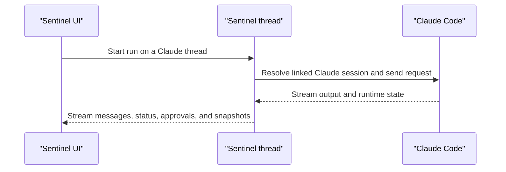

Sentinel can run a thread on your local Claude Code install.

It drives Claude Code through the Claude Agent SDK. The model runtime changes, but the thread model and app shell stay where they are.

## Setup

| What            | Details                                                                    |
| --------------- | -------------------------------------------------------------------------- |
| Install         | `npm install -g @anthropic-ai/claude-code`, from the Claude card or a terminal |
| Update          | `claude update` for the native installer, otherwise npm                    |
| Recommended     | Claude Code 2.1.280 or newer; 2.1.111 and newer still work                 |
| Home variable   | `CLAUDE_CONFIG_DIR`                                                        |
| Binary override | The instance's binary path, or `SENTINEL_CLAUDE_PATH` for the default instance |

Sentinel always runs the Claude Code you installed. It does not ship its own copy.

## Sign-in

- **Sign in with Claude** runs `claude auth login` in a terminal inside the Claude card.
- **Use an API key** stores the key encrypted on the instance as `ANTHROPIC_API_KEY`.

Give each account its own instance with its own home directory to keep them apart.

## What Sentinel keeps for a Claude thread

A Claude-backed thread can carry:

- Claude session ID
- permission mode
- working directory
- model
- the instance it runs on

That is enough for Sentinel to reopen the thread and keep the runtime connection lined up with the rest of the thread state.

Sentinel keeps the durable thread record. Claude Code keeps the active local session.

## Permission and plan mode

Claude threads use Sentinel's *Default* and *Full* permission modes. The mode lives with the thread state, so a reopened thread keeps it.

Plan mode is Claude's own. Switching a thread in or out of plan mode starts a new Claude session.

## Models and usage

Sentinel asks Claude Code for its models and fills in details from the [engine manifest](/docs/engines-and-runtime/engines-overview#the-engine-manifest), such as context windows and the default model.

If Claude Code is installed but has not reported any models yet, the manifest's Claude models stand in, so the thread UI does not stall out. Custom models on the instance are added to the list.

Claude reports plan rate limits while it runs, so the composer and the Claude card show the current usage windows.

## Run shape

1. Resolve the saved Claude-linked thread state.
2. Send the current turn into the Claude session.
3. Stream output and status back through the thread.
4. Persist the updated state in Sentinel around the runtime.

## What stays in Sentinel

Even when Claude Code is running the thread, Sentinel still owns:

- the thread list
- the workspace state
- the repo panels
- the shell
- settings

## Code references

- [`state/claude.ts`](https://github.com/Cronacl/Sentinel/blob/main/src/lib/ai/chat/engines/state/claude.ts)
- [`claude-sdk.ts`](https://github.com/Cronacl/Sentinel/blob/main/src/lib/ai/chat/engines/claude-sdk.ts)
- [`catalog.ts`](https://github.com/Cronacl/Sentinel/blob/main/src/lib/ai/chat/engines/catalog.ts)
